<!--
CONFIG
FULL_NAME: Edwin Alejandro Esquivel Bahamon
GITHUB_USER: edwin-esquivel-ADSO
EMAIL: esquivel202414@gmail.com
CODE_ORGANIZATION: code-sena
-->

<!-- ANIMATED TERMINAL BANNER (VIM PROFILE + DYNAMIC TECH CORE) -->
<a href="https://github.com/edwin-esquivel-ADSO">
  <picture>
    <source media="(prefers-color-scheme: dark)" srcset="assets/banner-dark.svg">
    <source media="(prefers-color-scheme: light)" srcset="assets/banner-light.svg">
    
  </picture>
</a>

 

<!-- TYPEWRITER ANIMATION (ELECTRIC INDIGO/VIOLET) -->

 

---

## 👨‍💻 `$ whoami --brief`

> *"Transformando retos complejos en software escalable, dinámico y centrado en el usuario."*

👋 ¡Hola! Soy **Edwin Alejandro Esquivel** (*Alejo | Stack*), Desarrollador Full-Stack y Tecnólogo en **Análisis y Desarrollo de Software (ADSO - Ficha 3413974)** en el SENA (Neiva, Colombia).

Como programador y colaborador activo en diversos proyectos de software, me apasiona diseñar e implementar soluciones de extremo a extremo: desde interfaces de usuario reactivas con **React**, **Next.js** y **TypeScript**, hasta arquitecturas backend escalables con **Laravel (PHP)**, **Node.js** y **Go**.

Apasionado por la innovación y los desafíos de alto impacto, participo activamente en **hackathones** de desarrollo colaborativo (como la **Hackathon Devurity 24h**, donde creamos **TrazaCao**), construyendo aplicaciones funcionales bajo presión y adoptando continuamente herramientas de vanguardia e Inteligencia Artificial. 🚀

---

## 🌐 `$ connect --socials`

&nbsp;&nbsp;
&nbsp;&nbsp;
&nbsp;&nbsp;
&nbsp;&nbsp;
&nbsp;&nbsp;

---

## `$ cat tech-stack.yaml`

<table border="1" cellpadding="14" bgcolor="#17171c">
  <thead>
    <tr>
      <th colspan="2" align="left"><code>edwin-esquivel:~$ cat tech-stack.yaml</code></th>
    </tr>
  </thead>
  <tbody>
    <tr>
      <td width="50%" valign="top"><code>├─ 🚀 languages_core:</code>  
         
        <code>TypeScript · JavaScript · PHP · Go · HTML5 · CSS3</code>
      </td>
      <td width="50%" valign="top"><code>├─ ⚛️ frontend_ecosystem:</code>  
         
        <code>React · Next.js · TailwindCSS · Bootstrap · Three.js</code>
      </td>
    </tr>
    <tr>
      <td valign="top"><code>├─ ⚙️ backend_apis:</code>  
         
        <code>Node.js · Express · Laravel (PHP) · RESTful APIs</code>
      </td>
      <td valign="top"><code>├─ 🗄️ databases_storage:</code>  
         
        <code>MySQL · PostgreSQL · Modelado Relacional</code>
      </td>
    </tr>
    <tr>
      <td valign="top"><code>├─ ☁️ cloud_devops:</code>  
         
        <code>Vercel (CI/CD) · Docker · Git · GitHub Workflows</code>
      </td>
      <td valign="top"><code>╰─ 📦 tooling_environment:</code>  
         
        <code>NPM · PNPM · VS Code · Postman · Linux / Bash</code>
      </td>
    </tr>
  </tbody>
  <tfoot>
    <tr>
      <td colspan="2"><code>status: ready_for_production&nbsp;&nbsp;·&nbsp;&nbsp;environment: continuous_learning&nbsp;&nbsp;·&nbsp;&nbsp;focus: full_stack_architecture</code></td>
    </tr>
  </tfoot>
</table>

---

## ⚡ `$ ls --featured-projects`

<table width="100%">
  <tr>
    <td width="50%" valign="top">
      <h3>🤖 ViaNova IA</h3>
      
Plataforma interactiva con integración de Inteligencia Artificial para asistencia y flujos de trabajo inteligentes.

      
<b>Stack:</b> <code>TypeScript</code> <code>Next.js</code> <code>IA</code> <code>Vercel</code>

      
      
    </td>
    <td width="50%" valign="top">
      <h3>🧬 BioSmart</h3>
      
Aplicación web orientada a biotecnología, gestión inteligente de procesos y monitoreo bio-sostenible.

      
<b>Stack:</b> <code>JavaScript</code> <code>React</code> <code>TailwindCSS</code> <code>Vercel</code>

      
      
    </td>
  </tr>
  <tr>
    <td width="50%" valign="top">
      <h3>🌿 EcoGuardian</h3>
      
Solución interactiva para monitoreo ambiental, sostenibilidad y concientización ecológica activa.

      
<b>Stack:</b> <code>JavaScript</code> <code>React</code> <code>TailwindCSS</code> <code>Vercel</code>

      
      
    </td>
    <td width="50%" valign="top">
      <h3>🍫 TrazaCao</h3>
      
Plataforma de trazabilidad de cacao creada contrarreloj en la <b>Hackathon Devurity (Cámara de Comercio - 24 horas)</b>.

      
<b>Stack:</b> <code>JavaScript</code> <code>React</code> <code>Vercel</code>

      
      
    </td>
  </tr>
</table>

---

## 📈 `$ git log --activity --consistency`

<table border="0">
  <tr>
    <td valign="middle" align="center">
      
    </td>
    <td valign="middle" align="center">
      
    </td>
  </tr>
</table>

 

  

Hecho con dedicación y código limpio · <b>Edwin Alejandro Esquivel (Alejo | Stack)</b> · Neiva, Colombia 🇨🇴

